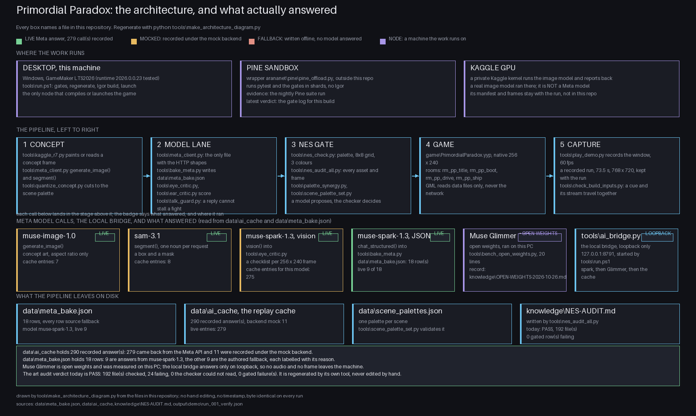

# Primordial Paradox

A retro role playing game about Greek gods in modern England, where you can win a fight by finding the right words.


## What it is

A father drives his son south to Southampton as the veil between the gods' world and ours wears thin. This is a GameMaker adventure at 256 by 240 pixels, with 8 by 8 tiles, limited palettes and checks against NES picture chip rules. In a battle, you can type or speak your own reply to a sailor instead of choosing a written line. His answer and his mercy meter react to what you said.

## Architecture



Every box in that picture names a file in this repository: the game at 256 by 240, the tools that enforce the picture chip's limits, the loopback bridge the game talks through, the Meta models with the state of their recorded answers beside them, Muse Glimmer running here under open weights, and the replay cache that lets the demo run with no network. `python tools/make_architecture_diagram.py` redraws it from those files, `--check-modules` proves every named path exists, and `--check-reproducible` builds it twice and compares the bytes.

## Built during the event

The event runs from 26 October to 4 November 2026. Work since the frozen baseline includes:

- A guided demo route, improved ship scenes and dialogue, and revised battle presentation.
- New pixel palette checks, with their test and measurement tools.
- An architecture diagram and records that separate baseline work from event work.

See the complete event diff:

```sh
git diff --stat hackathon-baseline-2026-10-25..HEAD
```

## Meta AI in this game

- **`muse-spark-1.3`:** `tools/bake_meta.py` calls it to judge dialogue. `tools/eye_critic.py` also sends it frames for art review. The live TALK path asks the same model through `tools/ai_bridge.py`, the loopback bridge this repository ships and `tools/run.ps1` starts before the game.
- **`muse-image-1.0`:** `tools/meta_client.py` calls `generate_image()` for concept art and `edit_image()` for revisions.
- **`sam-3.1`:** `tools/meta_client.py` calls `segment()` to separate a subject from its background.

Live and replayed, measured on 2026-10-27 20:35 UTC. These integrations use the Meta Model API through `tools/meta_client.py`, and the recorded cache is the evidence:

- **Recorded against the live API:** 279 of the 290 entries in `data/ai_cache`, covering every kind: 250 chat, 22 vision, 2 image, 1 edit and 4 segmentation calls. `python tools\meta_client.py --cache-status` recomputes that count from the entries themselves, and the 11 entries that are not live are labelled mock.
- **The TALK rows are recorded, not fetched:** 9 of the 18 rows in `data/meta_bake.json` are `muse-spark-1.3` answers read back from `data/ai_cache`, every one of them a recorded entry with `network: true` between 2026-10-27T02:12:30Z and 03:46:38Z, and the other 9 are the card's own pool line, each one labelled with its reason in the row and counted in the bake block (baked 2026-10-27T20:28:49Z, mode replay, network false, 0 unlabelled rows). The bake asks each request from the current data and serves it by request hash, so the 7 rows whose request text the voice punch-up changed (the percy and deck_hound option lines) no longer match a recorded answer and serve their authored line labelled `no live answer`, and 2 recorded answers are still refused for moving an effect their option is not authored to move; the row keeps the authored effect and says so.
- **The eye critic is live:** `muse-spark-1.3` scored the six frames of the newest nightly run, 2026-10-26, and `data/eye_ledger.csv` holds one row per call naming the frame it read. The frames and the review text are generated output and are not tracked; the ledger is.
- **Measured spend:** 3.3372 USD at the documented list prices for every live call in the cache, itemised in [knowledge/META-SPEND.md](knowledge/META-SPEND.md).

The demo never needs the network. For every Python tool, `PP_AI_MODE=replay` reads the recorded answers in `data/ai_cache` and makes no request, so it needs no key; `record` is the mode that writes a new answer and `live` calls without writing. The game itself defaults to replay, reading `data/talk_live_tape.json` without opening a network connection, and F6 switches between replay and live mode.

Art in this build was generated with Muse Image 1.0 and cut out with SAM 3.1, used under Meta's terms as confirmed by the entrant.

### Meta in the pipeline

`tools/meta_art.py` runs one asset from prompt to NES frame and keeps every step beside the finished picture, so a reader can check the Meta call instead of taking it on trust. The reference run is the title backdrop, and the files it left are tracked in the project's records folder, `knowledge/meta_art_reference/title_backdrop_c1`, so a fresh clone holds the same evidence without running anything. The tool writes every run to `output/meta_art/title_backdrop/c1` too, which is a local output directory that git ignores:

| step | file beside it | measured |
| --- | --- | --- |
| request to `muse-image-1.0` at 1024 by 1024 | `request.json` | 0.0100 USD |
| the answer as recorded, network true | `cached_response.json` | recorded 2026-10-27T08:58:17Z |
| `sam-3.1` asked for "the temple" | `sam_mask.json` | 0.0025 USD, the answer was empty, so no mask was written |
| the frame at 256 by 240 | `frame_nes.png` | 4 colours, 960 tiles |
| concept beside frame | `comparison.png` | 96.75 percent of pixels changed, mean Delta E 19.59 |

The tracked folder holds `request.json`, `cached_response.json`, `sam_mask.json`, `frame_nes.png`, `comparison.png` and the run's own record of itself, `evidence.json`, so the whole chain from prompt to frame is in the clone. `concept.png`, the 1024 by 1024 picture the frame was cut from, stays in the local run folder at 2.6 MB and is not tracked.

That frame passes the project's NES limits: `tools/nes_check.py` passes it at 256 by 240 and 960 tiles with the backdrop declared `$0F`; `tools/palette_synergy.py --gate` reports 0 gated failures across its 10 scene entries; `nes_composite_check.check_frame()` reports 0 problems in its palette, background and screen sections. An empty segmentation answer is recorded as a missing cut and never drawn as a guessed silhouette. Two further assets, the quay at night and the ship deck, are queued on the same chain and are not rendered yet.

## Run it

**Play or build: Windows, GameMaker LTS2026 and Python 3.** Run this from the repository root. It checks the data, builds the game and opens it. The first fight is the place to try TALK, then SAY IT YOURSELF.

```powershell
powershell -NoProfile -ExecutionPolicy Bypass -File tools\run.ps1
```

**The talk bridge.** That same command starts `tools/ai_bridge.py` on 127.0.0.1 port 8791 before the game and stops it after, so a live TALK turn gets a verdict from `muse-spark-1.3` when a Meta key is in the environment, then from the local model, then from the recorded answers in `data/ai_cache/bridge`. It never sends audio off this PC. A bridge that will not start prints a warning and the fight falls back to the recorded answers, -NoBridge skips it, and replay mode needs no server at all.

**Check the data: Python 3 only.** Install the dependency, then run the checker. Neither step needs GameMaker.

```sh
python -m pip install -r tools/requirements.txt
python tools/check_data.py
```

## Checks on this tree

These are the four commands the submission checklist tells a reader to run. None of the badges is typed by hand: `python tools/readme_badges.py --write` runs every gate, renders each badge from that run, and rewrites the table, and `--verify` refuses a README that disagrees with the tree. A red badge is a gate that is failing today, and it is left red on purpose.

<!-- README-BADGES:START -->

| gate | badge | command | result |
| --- | --- | --- | --- |
| check_data |  | `python tools/check_data.py` | PASS |
| check_cleanroom |  | `python tools/check_cleanroom.py` | PASS |
| nes_audit_all |  | `python tools/nes_audit_all.py` | PASS |
| play_demo --check |  | `python tools/play_demo.py --check` | FAIL |

Written by `python tools/readme_badges.py --write`, which reruns every gate above and renders the badges from that run; `python tools/readme_badges.py --verify` refuses a README that disagrees with the tree.
<!-- README-BADGES:END -->

## How it was made

Nayil Arana directs specialised AI agents through a shared task board. Every claimed change requires a reproducible check, and a different agent reruns it before the work counts as done. Read [BUILT-WITH-AGENTS.md](BUILT-WITH-AGENTS.md). The build and publish machinery behind the game is formally verified; read [FORMAL-VERIFICATION.md](docs/FORMAL-VERIFICATION.md).

## Licence and credits

All rights reserved today; see [LICENCE](LICENCE) for terms and [CREDITS.md](CREDITS.md) for third party notices.
