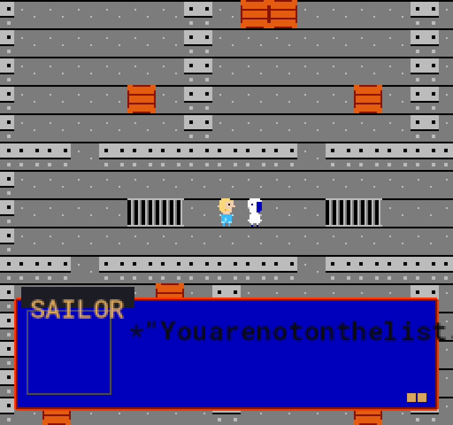

# Primordial Paradox

A retro role playing game about Greek gods in modern England, where you can win a fight by finding the right words.



## What it is

A father drives his son south to Southampton as the veil between the gods' world and ours wears thin. This is a GameMaker adventure at 256 by 240 pixels, with 8 by 8 tiles, limited palettes and checks against NES picture chip rules. In a battle, you can type or speak your own reply to a sailor instead of choosing a written line. His answer and his mercy meter react to what you said.

## Built during the event

The event runs from 26 October to 4 November 2026. Work since the frozen baseline includes:

- A guided demo route, improved ship scenes and dialogue, and revised battle presentation.
- New pixel palette checks, with their test and measurement tools.
- An architecture diagram and records that separate baseline work from event work.

See the complete event diff:

```sh
git diff --stat hackathon-baseline-2026-10-25..HEAD
```

## Meta AI in this game

- **`muse-spark-1.3`:** `tools/bake_meta.py` calls it to judge dialogue. `tools/eye_critic.py` also sends it frames for art review. The live TALK path asks the same model through a local bridge this repository does not ship.
- **`muse-image-1.0`:** `tools/meta_client.py` calls `generate_image()` for concept art and `edit_image()` for revisions.
- **`sam-3.1`:** `tools/meta_client.py` calls `segment()` to separate a subject from its background.

These integrations use the Meta API through `tools/meta_client.py`. No live Meta response is claimed: recorded mock answers and written fallbacks are labelled, not presented as live results. For Python tools, `PP_AI_MODE=replay` reads `data/ai_cache` and skips live calls, so it needs no key. The game defaults to replay, reading `data/talk_live_tape.json` without opening a network connection; F6 switches between replay and live mode.

## Run it

**Play or build: Windows, GameMaker LTS2026 and Python 3.** Run this from the repository root. It checks the data, builds the game and opens it. The first fight is the place to try TALK, then SAY IT YOURSELF.

```powershell
powershell -NoProfile -ExecutionPolicy Bypass -File tools\run.ps1
```

**Check the data: Python 3 only.** Install the dependency, then run the checker. Neither step needs GameMaker.

```sh
python -m pip install -r tools/requirements.txt
python tools/check_data.py
```

## How it was made

Nayil Arana directs specialised AI agents through a shared task board. Every claimed change requires a reproducible check, and a different agent reruns it before the work counts as done. Read [BUILT-WITH-AGENTS.md](BUILT-WITH-AGENTS.md).

## Licence and credits

All rights reserved today; see [LICENCE](LICENCE) for terms and [CREDITS.md](CREDITS.md) for third party notices.
