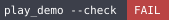
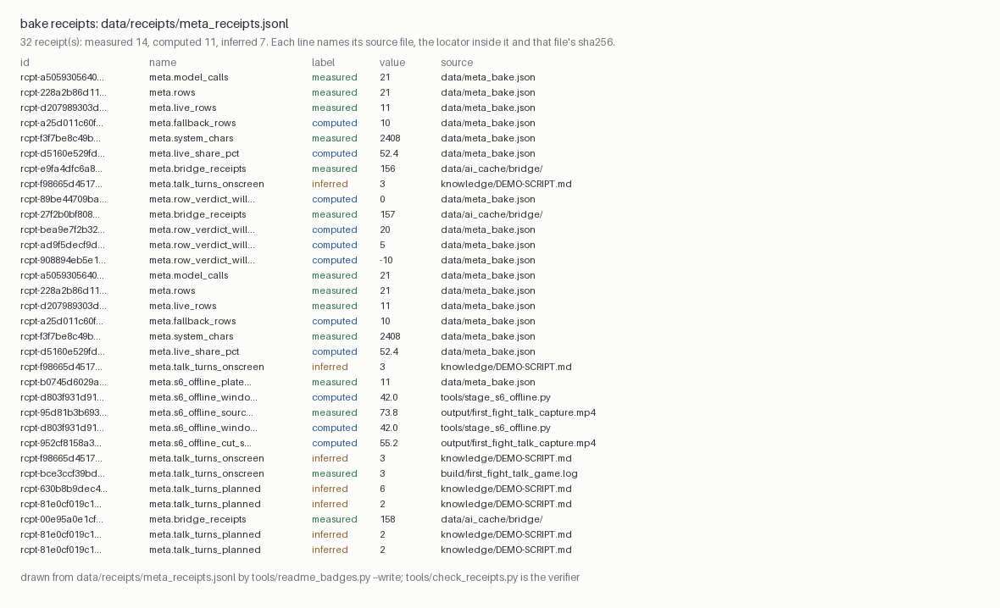
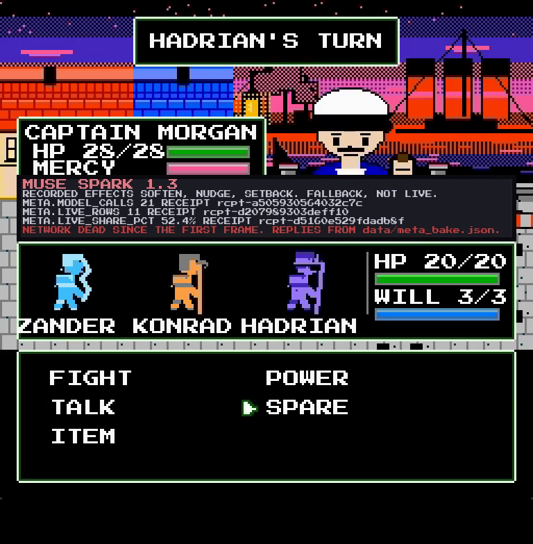

# Primordial Paradox

You play a retro role playing game in the style of the 8-bit NES, an old Nintendo console.

You meet Greek gods reincarnated in modern England.

You win fights by talking as well as by hitting.

## The game

A hurricane is battering Southampton's Town Quay. Percy, the reincarnation of Poseidon, is possessed and is causing it. Captain Morgan is possessed and is causing it too.

Zander (Zeus), Konrad (Kronos) and Hadrian (Hades) have to stop them so they return to their usual selves.

You can stop an enemy in two ways.

* Talk to an enemy and answer well to fill its MERCY meter, which measures forgiveness, then choose SPARE, which lets it live.
* Take its HP to zero. Then it disintegr

## Play it

Download the hackathon repository at https://github.com/NayilRArana/primordial-paradox-hackathon, which holds the project files.

Open the `play` folder. Double-click `PrimordialParadox.exe` (Windows, nothing to install).

Controls:

* arrow keys move
* Z confirms
* X cancels
* Enter starts and sends in the TALK box, the in game message box
* hold X to skip the credits

## How it is built

The game is a GameMaker project at 256 by 240 pixels.

Python is used only for tooling:
- the NES picture chip gate (`tools/nes_check.py`), which checks image limits
- the data checks
- the tests (about 2,700)
- the art and music pipelines, which prepare assets
- the build scripts, which assemble the release

The music is original chiptune, simple retro game music. It was composed with the counterpoint toolchain in `tools/counterpoint/`.

Meta's `muse-spark-1.3` answers the TALK box and judges dialogue. Its answers are recorded in `data/ai_cache` so the game plays offline.

<!-- README-BADGES:START -->

## Checks on this tree

These are the four commands the submission checklist tells a reader to run. No badge here is typed by hand: `python tools/readme_badges.py --write` runs every gate, renders one picture per gate from that run, and rewrites this section, and `--verify` refuses a page that disagrees with the tree. A red badge is a gate that is failing today, and it is left red on purpose.

| gate | badge | command | result |
| --- | --- | --- | --- |
| check_data |  | `python tools/check_data.py` | PASS |
| check_cleanroom |  | `python tools/check_cleanroom.py` | PASS |
| nes_audit_all |  | `python tools/nes_audit_all.py` | PASS |
| play_demo --check |  | `python tools/play_demo.py --check` | FAIL |

## The pass lines, as the gates print them

The table above is the verdict; these are the last lines the two data gates printed when this section was written. Nothing here is typed in, so a gate that failed on this tree shows the line it failed with, and `python tools/readme_badges.py --verify` refuses a page whose lines a fresh run does not print.

```text
check_data: all files pass
check_cleanroom: no study reference, no foreign name, no foreign phrase, every module reviewed
```

## NES limits, enforced in code

The 8 bit look is a hardware budget, not a filter. The chip draws 256 by 240 pixels out of 8 by 8 pixel tiles and 16 by 16 pixel attribute areas, and shows at most 25 colours at once. Every number below is read out of the file it names when this section is written, so the page cannot drift away from the code.

What the engine enforces while the game runs:

* `game/scripts/pp_config/pp_config.gml` holds the frame at PP_FRAME_W 256 by PP_FRAME_H 240, the dodge arena at PP_ARENA_W 160 by PP_ARENA_H 100, the 8 pixel marker and the PP_ARENA_CAP_STEPS 900 cap, and no magic number lives outside that file and `data/`.
* `game/scripts/pp_look/pp_look.gml` resolves a colour role only inside the palette set the room declares. A role the set does not carry draws as PP_COLOUR_MISSING and is logged, because a fallback to the master palette would spend a colour past the 16 a screen may hold.
* `game/scripts/pp_data/pp_data.gml` turns a palette index into a drawing colour through `data/palette_ppu.json` and returns PP_COLOUR_MISSING for an index that is out of range, so a colour drawn at run time is a Ricoh 2C02 output and never a design colour.

What the checkers prove, over the pixels:

* `tools/nes_check.py` checks one sheet or one layer: every pixel is an output of the chip, the image cuts into 8 pixel tiles, a sprite tile carries 3 opaque colours, an attribute area carries 3 plus the shared backdrop, and the image stays at or under 25 colours. It reads its palette from `data/nes_palette.json`.
* `tools/nes_composite_check.py` checks one finished 256 by 240 frame with both layers together: 4 background palettes and 4 sprite palettes as a set cover, 8 sprites on any scanline, 64 in OAM, 25 colours.
* `tools/nes_audit_all.py` runs both over every art source and every 256 by 240 frame, and fails on a gated file. Its last run on this tree is the nes_audit_all row above.
* `tools/check_runtime_palette.py` covers what no picture can: the flat rectangles and glyphs the game draws at run time, resolved through the palette table above.

How to check it yourself:

```sh
python tools/check_data.py
python tools/check_cleanroom.py
python tools/nes_audit_all.py --quiet
python tools/readme_badges.py --verify
```

Exit 0 means pass, and nothing else does. check_data holds every data file to its schema, its ranges and its references, and simulates every bullet recipe with the engine's own rules. check_cleanroom refuses a study path, a foreign name, a foreign phrase and a module with no review row in `knowledge/CLEANROOM-REVIEW.md`. Its one exemption is generated geography: a card such as `data/maps/real_places.json` carries OpenStreetMap road and water names, and only those name lists are exempt, on evidence inside the file, with the count printed on every run.

## The local AI bridge, in this repo

The verdict in the TALK box comes from a service on this machine, and its wiring is in this tree rather than in a recording. Every path below is resolved against this checkout when this section is written:

* `tools/ai_bridge.py` is the whole server: Python standard library only, bound to `127.0.0.1` on port 8791, one deadline per request. Its ladder is tried in order, and every answer carries the rung that gave it, one of meta, open-weights, replay, fallback.
* `tools/meta_client.py` is the Meta rung: structured output against the schema built from the judge file, and no key means the rung is labelled unavailable and nothing is sent.
* `data/talk/sailor_judge.json` holds the system text, the line limits, the verdict map and the local model id, so the model picks a word and the data file decides the WILL number.
* `data/ai_cache/bridge` holds the recorded answers the replay rung serves, which is the path the demo plays with the network off.
* `tools/talk_scene_probe.py` makes the two real calls by hand and prints the rows the dialogue box would draw, and it refuses any host that is not loopback before it sends a byte.
* `tools/run.ps1` starts the bridge, checks the data, builds the project, launches the game and stops the bridge when the window closes.
* `docs/AI-BRIDGE.md` is the long page: the ladder rung by rung, what was measured on this PC, and what is not proven.
* `docs/REVIEW-CHECKLIST.md` is the picture review gate: a reviewer rejects a full colour frame and requires the palette and sprite limits above, and `tools/review_gate.py` is the one command that runs it over a file.

Build and start, from the repository root:

```sh
python tools/ai_bridge.py --selftest
python tools/talk_scene_probe.py --offline
python tools/ai_bridge.py --serve --warm
powershell -NoProfile -ExecutionPolicy Bypass -File tools/run.ps1
```

`--selftest` prints one line per rung without spending a Meta call; `--offline` opens no socket at all; `--serve --warm` is the server the last line starts; and `tools/run.ps1` is the whole build, from the data checks through Igor to the running game. `PP_AI_MODE=replay` starts the ladder at the recorded rung, which is why the demo plays with no network and no model loaded.

## The bake receipts

The credits say a Meta model wrote the scenes and judged the TALK box, and the sections above say which files call it. This is where the numbers behind those credits are receipted, so a reader re-reads a source instead of believing a sentence:

* `data/receipts/meta_receipts.jsonl` is the ledger: 32 receipt(s), measured 14, computed 11, inferred 7. Every line names the source file, the locator inside it and that file's sha256.
* `tools/receipts.py` writes the receipts, and its three labels are the only ones allowed: measured is a value read out of a committed file and re-hashable from it, computed is arithmetic over numbers measured in the same ledger, and inferred means no file records the value and the receipt says so in words.
* `tools/check_receipts.py` is the verifier. It exits 0 only when every receipt resolves, and a receipt whose source changed after it was written is a NOTE that asks for a re-issue rather than a pass. Run it with no argument and it re-reads the newest take verify file that carries a `meta_numbers` block, one number at a time.
* The picture below is drawn from those ledger rows by `python tools/readme_badges.py --write`, so it shows the receipts the file holds and cannot show one it does not. `--verify` refuses the page when the picture is missing or was drawn for a ledger of another size, and refuses the sentence above when the label counts moved. An edit inside one line keeps that size, so the picture follows the next `--write` rather than the page.



The reference Meta art run is the title backdrop. Its small files are tracked in `knowledge/meta_art_reference/title_backdrop_c1`, so a fresh clone holds the same evidence without running anything, and the same run is written to `output/meta_art/title_backdrop/c1`, a local folder git ignores, which is why that one path is exempt from the on disk check. The tracked answer in it, `cached_response.json`, says network true and was recorded 2026-10-27T08:58:17Z.

The prose on this page is written by `muse-spark-1.3` through `tools/readme_meta.py`; the table above, the pass lines under it, the limits section, the bridge section, the receipts section, the receipts picture and the badges are written by `python tools/readme_badges.py --write`. Each tool keeps out of the other's region of the file.
<!-- README-BADGES:END -->

## The tagged tree and tonight's finished cut

This section sits outside the block the badge tool owns. `python tools/readme_badges.py --write` rewrites its own region and leaves this one alone. You do not have to take the two PASS rows above on trust, and the 180 second video beside them is measured, not claimed.

* The tag `nightly-clean-2026-11-15` is an annotated tag on a commit whose parent is `461cb9a5`, and the tag's tree is that commit plus this page. The checkout behind it carries 1114 uncommitted paths from other lanes and none of them is in the tag. `git archive nightly-clean-2026-11-15` extracts 2,515 files, the same count `git ls-tree -r --name-only nightly-clean-2026-11-15` prints, so the tag's tree is exactly the commit and nothing from the dirty working tree.
* Both data gates were run inside that export, not in the dirty checkout, and both exit 0. check_cleanroom scans 811 files there against the 905 it scans in the checkout, which is the uncommitted paths it is not looking at:

```text
check_data: all files pass
check_cleanroom: 811 files scanned for 26 names and 12 phrases, 48 GML modules, 0 awaiting review, 3 downloaded map file(s) skipped, 121 OSM place name(s) exempt in 1 generated geography card(s)
check_cleanroom: no study reference, no foreign name, no foreign phrase, every module reviewed
```

* `output/demo/nightly-2026-11-15d.mp4` is the finished cut, built 2026-11-15 21:21 local: 180.000 s, 10,800 frames, 768 by 784 at 60 fps, h264 with an aac track, 17,217,704 bytes. `python tools/demo_cut_180.py --verify --video output/demo/nightly-2026-11-15d.mp4 --workdir <scratch>` exits 0 with 49 rows PASS and 0 FAIL, and writes `output/demo/nightly-2026-11-15d_verify.json`. The rows include the six captions, the four S5 plates, thirteen title card lines up at 1.0 s and 15.8 s, CONTINUE dim on the boot menu, 0 blue band pixels at 15.0 s, and the narrator above the ducked game track in all six windows.
* `tools/demo_cut_180.py --build` is the tool that assembles the six shots to the 180.00 s total; `tools/play_demo.py` is the recorder that produces source footage, and `knowledge/DEMO-AUTHORITY-RULING-2026-11-12.md` section 2 is why the cut, and not a recorder take, is the shipping video. The build and the verify above are one pass each on the same inputs, in the same minute.
* The gap the tag does not close, and the commit that does close it. The cut above needs seven paths the tag does not carry, and `HEAD` now carries every one of them: `tools/video_builder.py` and `data/slice.json`, which draw and hold the opaque 16.00 s card, landed in `ee1e9adb`; `tools/demo_cut_180.py`, `tools/demo_overlay.py` with its S5 verdict window, and the two tests that read them landed in `f31a8226`; `tools/demo_voiceover.py`, `data/demo/narration.json`, `knowledge/DEMO-SCRIPT.md` section 12 and `tests/test_demo_narration.py` landed in `ce8e2def`. `git archive HEAD` extracts 2,519 files, and a build from that export reads nothing in the working tree: `python tools/demo_cut_180.py --build --video output/demo/nightly-2026-11-15e.mp4` and `--verify` on the result both exit 0, 24 rows ok and 0 failed, at 180.000 s, 10,800 frames, 768 by 784 at 60 fps and 16,937,739 bytes, with `output/demo/nightly-2026-11-15e_verify.json` written beside it. The take the 2026-11-16 judge panel scored, `output/demo/nightly-2026-11-15.mp4`, is not overwritten.


## The AI verdict on screen

TALK turns in the Morgan fight come from `data/meta_bake.json`. That file records `muse-spark-1.3` as the model.

The demo's fifth shot shows this on the screen itself, not in a caption.

From 1:18.00 to 1:50.00 one NES window sits in the strip of battle frame between the enemy plate and the party panel. The enemy's HP and MERCY bars and the party line stay visible behind it. Every word in it is read out of the record at draw time:

* the model, by the display name `data/credits.json` prints for the bake's own model id, so the name on the frame and the name in the credits are one string read from one place;
* the decision, as the effects the three Morgan rows record, checked against the verdict map in `data/talk/sailor_judge.json`, and said in words to be fallback rows, because that is what the bake holds for them and a label that said otherwise would be a claim about a call never made;
* the three bake receipts, `meta.model_calls` 21, `meta.live_rows` 11 and `meta.live_share_pct` 52.4, each under the id of the ledger receipt in `data/receipts/meta_receipts.jsonl` that backs that number;
* the network line, from the file's own `offline` and `network` flags.

The picture below is frame 6,300 of the 180 second take built on 2026-11-16 and verified with `tools/demo_cut_180.py --verify`, which is 1:45.0, the clock the judge panel samples its stills at. The take itself is named output/demo/nightly-2026-11-16-verdict.mp4 and not linked, because git ignores `output/`:



`python tools/demo_overlay.py --shot S5 --frame IN.png --out OUT.png --verdict-box --only ""` draws the window.

`--check --verdict-box` measures it:

- The window is a real filled rectangle.
- Every line carries ink the blanked control does not.
- The three ids are the receipts the ledger holds.
- Both battle HUD bands are compared with the same frame drawn without the window and read unchanged.

## Where the code lives

This folder is the working files. It is the development tree.

The submission splits into two public repositories:

* the engine as it was before the event (https://github.com/NayilRArana/primordial-paradox-engine)
* the work done during the event (https://github.com/NayilRArana/primordial-paradox-hackathon)

## Licence and credits

See `LICENCE` and `CREDITS.md`.

A Meta model, an automated text tool, wrote this README through `tools/readme_meta.py`. `tests/test_readme_meta.py` fails if it is edited by hand.

<!-- readme-author: muse-spark-1.3 body-sha256: 95c918e47c57bffe372d76f93e1d114a7fea487d578fc8c7a67a249fc6b88244 -->
