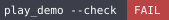

# Primordial Paradox

You play a retro role playing game in the style of the 8-bit NES, an old Nintendo console. You meet Greek gods reincarnated in modern England.

You win fights by talking as well as by hitting.

## The game

A hurricane is battering Southampton's Town Quay. Percy, the reincarnation of Poseidon, is possessed and is causing it. Captain Morgan is possessed and is causing it too.

Zander (Zeus), Konrad (Kronos) and Hadrian (Hades) have to stop them so they return to their usual selves.

Talk to an enemy and answer well to fill its MERCY meter, which measures forgiveness, then choose SPARE, which lets it live. Or take its HP, which means health, to zero. Then it disintegr

## Play it

Download the hackathon repository at https://github.com/NayilRArana/primordial-paradox-hackathon, which holds the project files. Open the `play` folder. Double-click `PrimordialParadox.exe` (Windows, nothing to install).

Controls:

* arrow keys move
* Z confirms
* X cancels
* Enter starts and sends in the TALK box, the in game message box
* hold X to skip the credits

## How it is built

The game is a GameMaker project at 256 by 240 pixels. GameMaker is the game engine.

Python is used only for tooling:
- the NES picture chip gate (`tools/nes_check.py`), which checks image limits
- the data checks
- the tests (about 2,700)
- the art and music pipelines, which prepare assets
- the build scripts, which assemble the release

The music is original chiptune, simple retro game music, composed with the counterpoint toolchain in `tools/counterpoint/`.

Meta's `muse-spark-1.3` answers the TALK box and judges dialogue. Its answers are recorded in `data/ai_cache` so the game plays offline.

<!-- README-BADGES:START -->

## Checks on this tree

These are the four commands the submission checklist tells a reader to run. No badge here is typed by hand: `python tools/readme_badges.py --write` runs every gate, renders one picture per gate from that run, and rewrites this section, and `--verify` refuses a page that disagrees with the tree. A red badge is a gate that is failing today, and it is left red on purpose.

| gate | badge | command | result |
| --- | --- | --- | --- |
| check_data |  | `python tools/check_data.py` | PASS |
| check_cleanroom |  | `python tools/check_cleanroom.py` | PASS |
| nes_audit_all |  | `python tools/nes_audit_all.py` | PASS |
| play_demo --check |  | `python tools/play_demo.py --check` | FAIL |

## NES limits, enforced in code

The 8 bit look is a hardware budget, not a filter. The chip draws 256 by 240 pixels out of 8 by 8 pixel tiles and 16 by 16 pixel attribute areas, and shows at most 25 colours at once. Every number below is read out of the file it names when this section is written, so the page cannot drift away from the code.

What the engine enforces while the game runs:

* `game/scripts/pp_config/pp_config.gml` holds the frame at PP_FRAME_W 256 by PP_FRAME_H 240, the dodge arena at PP_ARENA_W 160 by PP_ARENA_H 100, the 8 pixel marker and the PP_ARENA_CAP_STEPS 900 cap, and no magic number lives outside that file and `data/`.
* `game/scripts/pp_look/pp_look.gml` resolves a colour role only inside the palette set the room declares. A role the set does not carry draws as PP_COLOUR_MISSING and is logged, because a fallback to the master palette would spend a colour past the 16 a screen may hold.
* `game/scripts/pp_data/pp_data.gml` turns a palette index into a drawing colour through `data/palette_ppu.json` and returns PP_COLOUR_MISSING for an index that is out of range, so a colour drawn at run time is a Ricoh 2C02 output and never a design colour.

What the checkers prove, over the pixels:

* `tools/nes_check.py` checks one sheet or one layer: every pixel is an output of the chip, the image cuts into 8 pixel tiles, a sprite tile carries 3 opaque colours, an attribute area carries 3 plus the shared backdrop, and the image stays at or under 25 colours. It reads its palette from `data/nes_palette.json`.
* `tools/nes_composite_check.py` checks one finished 256 by 240 frame with both layers together: 4 background palettes and 4 sprite palettes as a set cover, 8 sprites on any scanline, 64 in OAM, 25 colours.
* `tools/nes_audit_all.py` runs both over every art source and every 256 by 240 frame, and fails on a gated file. Its last run on this tree is the nes_audit_all row above.
* `tools/check_runtime_palette.py` covers what no picture can: the flat rectangles and glyphs the game draws at run time, resolved through the palette table above.

How to check it yourself:

```sh
python tools/check_data.py
python tools/check_cleanroom.py
python tools/nes_audit_all.py --quiet
python tools/readme_badges.py --verify
```

Exit 0 means pass, and nothing else does. check_data holds every data file to its schema, its ranges and its references, and simulates every bullet recipe with the engine's own rules. check_cleanroom refuses a study path, a foreign name, a foreign phrase and a module with no review row in `knowledge/CLEANROOM-REVIEW.md`. Its one exemption is generated geography: a card such as `data/maps/real_places.json` carries OpenStreetMap road and water names, and only those name lists are exempt, on evidence inside the file, with the count printed on every run.

## The local AI bridge, in this repo

The verdict in the TALK box comes from a service on this machine, and its wiring is in this tree rather than in a recording. Every path below is resolved against this checkout when this section is written:

* `tools/ai_bridge.py` is the whole server: Python standard library only, bound to `127.0.0.1` on port 8791, one deadline per request. Its ladder is tried in order, and every answer carries the rung that gave it, one of meta, open-weights, replay, fallback.
* `tools/meta_client.py` is the Meta rung: structured output against the schema built from the judge file, and no key means the rung is labelled unavailable and nothing is sent.
* `data/talk/sailor_judge.json` holds the system text, the line limits, the verdict map and the local model id, so the model picks a word and the data file decides the WILL number.
* `data/ai_cache/bridge` holds the recorded answers the replay rung serves, which is the path the demo plays with the network off.
* `tools/talk_scene_probe.py` makes the two real calls by hand and prints the rows the dialogue box would draw, and it refuses any host that is not loopback before it sends a byte.
* `tools/run.ps1` starts the bridge, checks the data, builds the project, launches the game and stops the bridge when the window closes.
* `docs/AI-BRIDGE.md` is the long page: the ladder rung by rung, what was measured on this PC, and what is not proven.
* `docs/REVIEW-CHECKLIST.md` is the picture review gate: a reviewer rejects a full colour frame and requires the palette and sprite limits above, and `tools/review_gate.py` is the one command that runs it over a file.

Build and start, from the repository root:

```sh
python tools/ai_bridge.py --selftest
python tools/talk_scene_probe.py --offline
python tools/ai_bridge.py --serve --warm
powershell -NoProfile -ExecutionPolicy Bypass -File tools/run.ps1
```

`--selftest` prints one line per rung without spending a Meta call; `--offline` opens no socket at all; `--serve --warm` is the server the last line starts; and `tools/run.ps1` is the whole build, from the data checks through Igor to the running game. `PP_AI_MODE=replay` starts the ladder at the recorded rung, which is why the demo plays with no network and no model loaded.

The reference Meta art run is the title backdrop. Its small files are tracked in `knowledge/meta_art_reference/title_backdrop_c1`, so a fresh clone holds the same evidence without running anything, and the same run is written to `output/meta_art/title_backdrop/c1`, a local folder git ignores, which is why that one path is exempt from the on disk check. The tracked answer in it, `cached_response.json`, says network true and was recorded 2026-10-27T08:58:17Z.

The prose on this page is written by `muse-spark-1.3` through `tools/readme_meta.py`; the table above, the limits section, the bridge section and the badges are written by `python tools/readme_badges.py --write`. Each tool keeps out of the other's region of the file.
<!-- README-BADGES:END -->

## Where the code lives

This folder is the development tree, the working files.

The submission splits into two public repositories:

* the engine as it was before the event (https://github.com/NayilRArana/primordial-paradox-engine)
* the work done during the event (https://github.com/NayilRArana/primordial-paradox-hackathon)

## Licence and credits

See `LICENCE` and `CREDITS.md`.

This README is written by a Meta model, an automated text tool, through `tools/readme_meta.py`. `tests/test_readme_meta.py` fails if it is edited by hand.

<!-- readme-author: muse-spark-1.3 body-sha256: 6d4bfe4a5a1dbe77dac1cbc682831b6c2e4afa6f668d45f493fec33fa46cb57e -->
